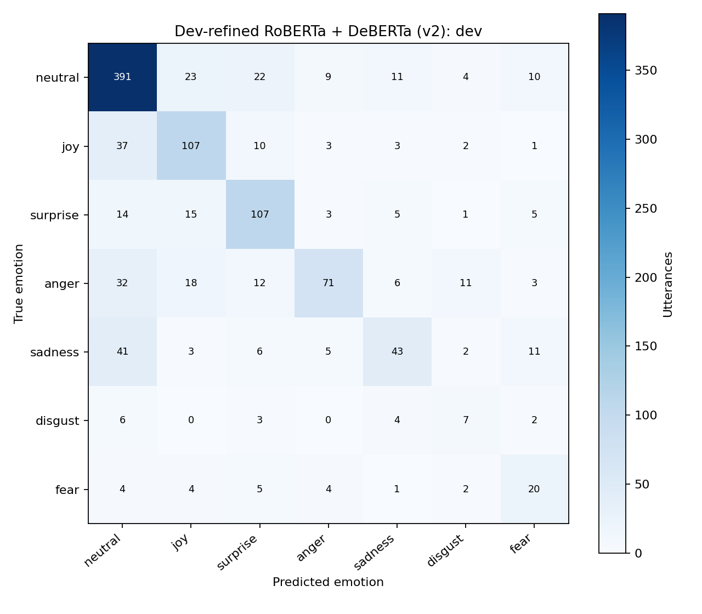
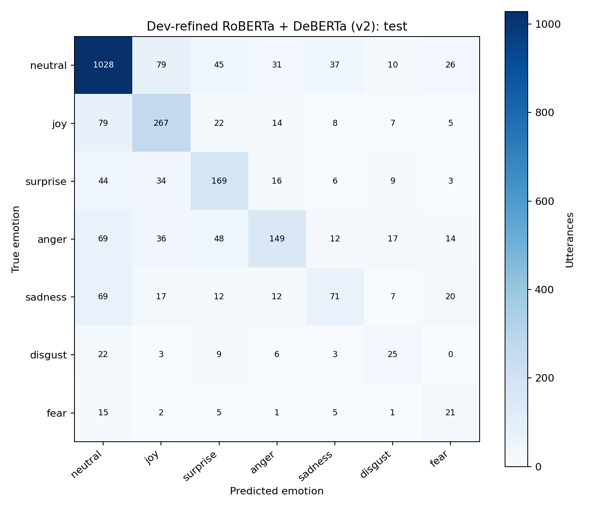

# Dev-refined RoBERTa + DeBERTa (v2)

All values below come from recorded artifacts; missing evidence is stated explicitly.

## Dev split

- Weighted F1: 0.6663284408072734
- Macro F1: 0.5510288189107523
- Accuracy: 0.672678088367899

| Emotion | Precision | Recall | F1 | Support |
|---|---:|---:|---:|---:|
| neutral | 0.7448 | 0.8319 | 0.7859 | 470 |
| joy | 0.6294 | 0.6564 | 0.6426 | 163 |
| surprise | 0.6485 | 0.7133 | 0.6794 | 150 |
| anger | 0.7474 | 0.4641 | 0.5726 | 153 |
| sadness | 0.5890 | 0.3874 | 0.4674 | 111 |
| disgust | 0.2414 | 0.3182 | 0.2745 | 22 |
| fear | 0.3846 | 0.5000 | 0.4348 | 40 |

Lowest class F1: disgust, fear. Inspect real errors before assigning causes.

Examples: [dev_review_examples.csv](dev_review_examples.csv).
Selection: up to five correct and five incorrect; class diversity then confidence.
Diagnostic examples do not estimate the frequency of errors.

## Test split

- Weighted F1: 0.6584726608460996
- Macro F1: 0.511166685087126
- Accuracy: 0.6628352490421456

| Emotion | Precision | Recall | F1 | Support |
|---|---:|---:|---:|---:|
| neutral | 0.7753 | 0.8185 | 0.7963 | 1256 |
| joy | 0.6096 | 0.6642 | 0.6357 | 402 |
| surprise | 0.5452 | 0.6014 | 0.5719 | 281 |
| anger | 0.6507 | 0.4319 | 0.5192 | 345 |
| sadness | 0.5000 | 0.3413 | 0.4057 | 208 |
| disgust | 0.3289 | 0.3676 | 0.3472 | 68 |
| fear | 0.2360 | 0.4200 | 0.3022 | 50 |

Lowest class F1: fear, disgust. Inspect real errors before assigning causes.

Examples: [test_review_examples.csv](test_review_examples.csv).
Selection: up to five correct and five incorrect; class diversity then confidence.
Diagnostic examples do not estimate the frequency of errors.

## Evidence gaps / limitations

- Learning curves: trainer_state.json/log_history unavailable; no curve was invented.
- Hardware, parameter count and latency: not recorded in this result artifact.

Text-only English MELD / Friends dialogues; multilingual and clinical performance is unvalidated.
Softmax confidence is not a calibrated probability of correctness.
Test error inspection is final reporting, not another hyperparameter-selection round.
