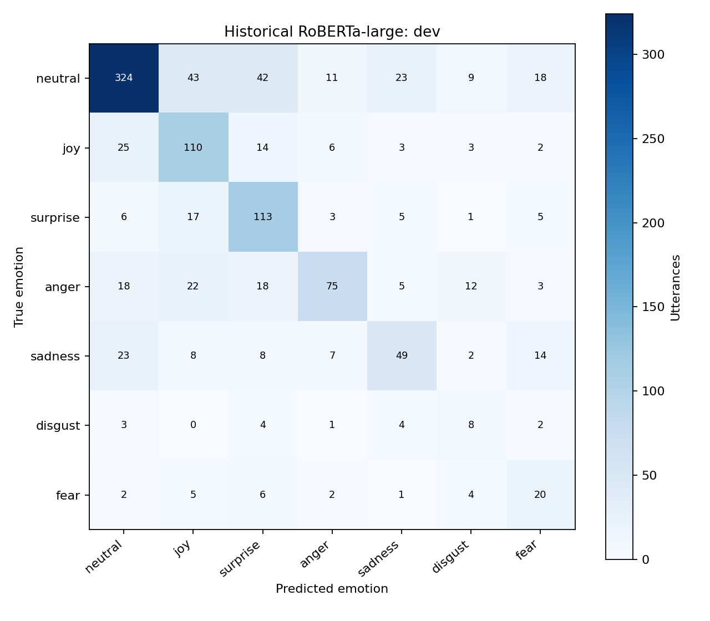
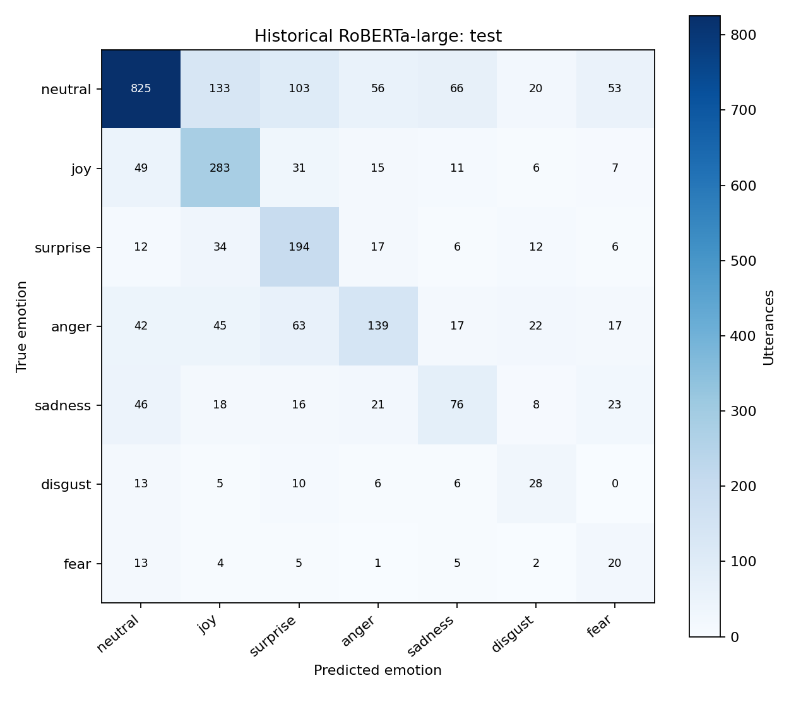

# Historical RoBERTa-large

All values below come from recorded artifacts; missing evidence is stated explicitly.

## Dev split

- Weighted F1: 0.6373612784797074
- Macro F1: 0.5277551793151282
- Accuracy: 0.630297565374211

| Emotion | Precision | Recall | F1 | Support |
|---|---:|---:|---:|---:|
| neutral | 0.8080 | 0.6894 | 0.7440 | 470 |
| joy | 0.5366 | 0.6748 | 0.5978 | 163 |
| surprise | 0.5512 | 0.7533 | 0.6366 | 150 |
| anger | 0.7143 | 0.4902 | 0.5814 | 153 |
| sadness | 0.5444 | 0.4414 | 0.4876 | 111 |
| disgust | 0.2051 | 0.3636 | 0.2623 | 22 |
| fear | 0.3125 | 0.5000 | 0.3846 | 40 |

Lowest class F1: disgust, fear. Inspect real errors before assigning causes.

## Test split

- Weighted F1: 0.6107844031356188
- Macro F1: 0.4726604310643204
- Accuracy: 0.5996168582375478

| Emotion | Precision | Recall | F1 | Support |
|---|---:|---:|---:|---:|
| neutral | 0.8250 | 0.6568 | 0.7314 | 1256 |
| joy | 0.5421 | 0.7040 | 0.6126 | 402 |
| surprise | 0.4597 | 0.6904 | 0.5519 | 281 |
| anger | 0.5451 | 0.4029 | 0.4633 | 345 |
| sadness | 0.4064 | 0.3654 | 0.3848 | 208 |
| disgust | 0.2857 | 0.4118 | 0.3373 | 68 |
| fear | 0.1587 | 0.4000 | 0.2273 | 50 |

Lowest class F1: fear, disgust. Inspect real errors before assigning causes.

## Evidence gaps / limitations

- dev: per-example predictions unavailable; evaluate a saved checkpoint for real examples.
- test: per-example predictions unavailable; evaluate a saved checkpoint for real examples.
- Learning curves: trainer_state.json/log_history unavailable; no curve was invented.
- Hardware, parameter count and latency: not measured in this legacy JSON.

Text-only English MELD / Friends dialogues; multilingual and clinical performance is unvalidated.
Softmax confidence is not a calibrated probability of correctness.
Test error inspection is final reporting, not another hyperparameter-selection round.
