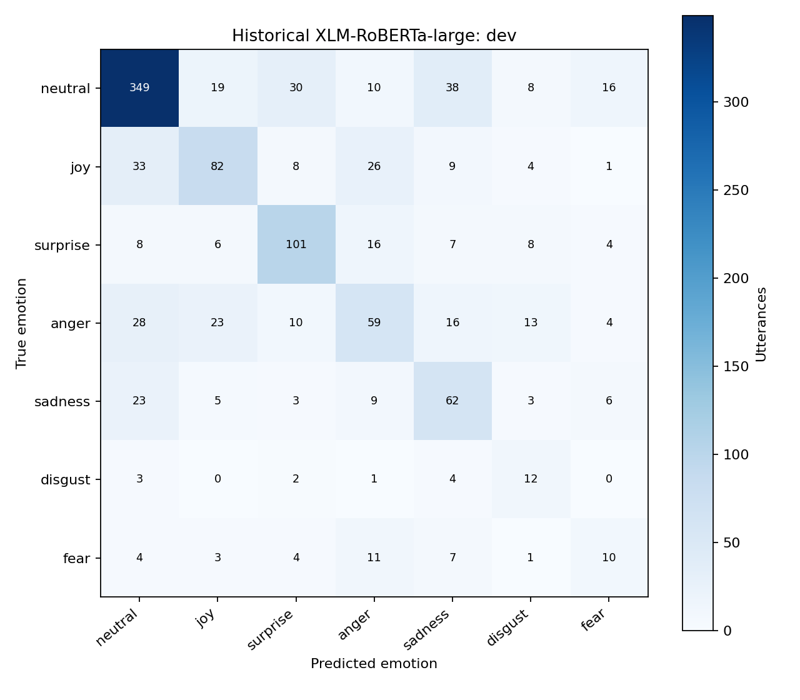
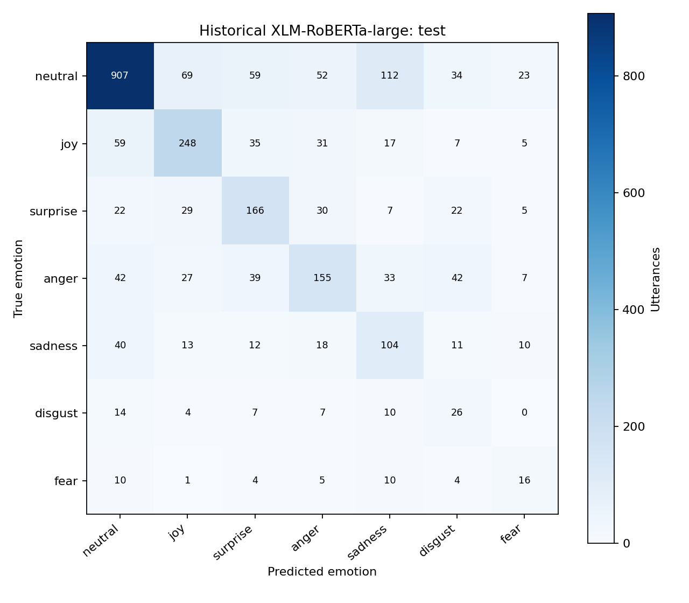

# Historical XLM-RoBERTa-large

All values below come from recorded artifacts; missing evidence is stated explicitly.

## Dev split

- Weighted F1: 0.6126245236751208
- Macro F1: 0.49260129305989586
- Accuracy: 0.6086564472497745

| Emotion | Precision | Recall | F1 | Support |
|---|---:|---:|---:|---:|
| neutral | 0.7790 | 0.7426 | 0.7603 | 470 |
| joy | 0.5942 | 0.5031 | 0.5449 | 163 |
| surprise | 0.6392 | 0.6733 | 0.6558 | 150 |
| anger | 0.4470 | 0.3856 | 0.4140 | 153 |
| sadness | 0.4336 | 0.5586 | 0.4882 | 111 |
| disgust | 0.2449 | 0.5455 | 0.3380 | 22 |
| fear | 0.2439 | 0.2500 | 0.2469 | 40 |

Lowest class F1: fear, disgust. Inspect real errors before assigning causes.

## Test split

- Weighted F1: 0.6355094905333674
- Macro F1: 0.48058652599267887
- Accuracy: 0.621455938697318

| Emotion | Precision | Recall | F1 | Support |
|---|---:|---:|---:|---:|
| neutral | 0.8291 | 0.7221 | 0.7719 | 1256 |
| joy | 0.6343 | 0.6169 | 0.6255 | 402 |
| surprise | 0.5155 | 0.5907 | 0.5506 | 281 |
| anger | 0.5201 | 0.4493 | 0.4821 | 345 |
| sadness | 0.3549 | 0.5000 | 0.4152 | 208 |
| disgust | 0.1781 | 0.3824 | 0.2430 | 68 |
| fear | 0.2424 | 0.3200 | 0.2759 | 50 |

Lowest class F1: disgust, fear. Inspect real errors before assigning causes.

## Evidence gaps / limitations

- dev: per-example predictions unavailable; evaluate a saved checkpoint for real examples.
- test: per-example predictions unavailable; evaluate a saved checkpoint for real examples.
- Learning curves: trainer_state.json/log_history unavailable; no curve was invented.
- Hardware, parameter count and latency: not measured in this legacy JSON.

Text-only English MELD / Friends dialogues; multilingual and clinical performance is unvalidated.
Softmax confidence is not a calibrated probability of correctness.
Test error inspection is final reporting, not another hyperparameter-selection round.
